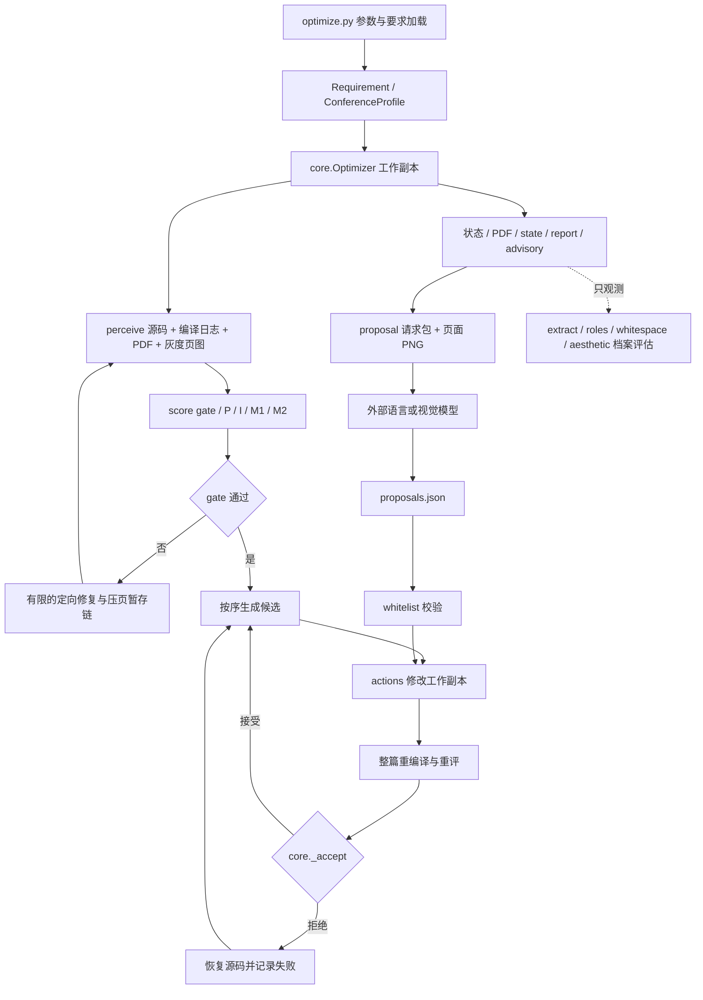

# texopt 当前仓库理解记录（2026-11-16）

> 此文保留 2026-11-16 的盘点快照。2026-11-19 已清理历史评测重复输入、像素缓存、两个内嵌 HTML 和三张 DOCX 回读图；源码与原始输入保留，见 [实际清理记录](CLEANUP_RESULT_20261119.md)。

这份记录以当前工作区源码为依据，服务于后续讨论、开发和材料核对。它不是优化运行报告，也不把历史说明中的承诺自动视为实现事实。本轮没有修改优化器、固定靶稿、会议规范、权重或论文原件。

## 1. 阅读范围与证据

首次盘点排除 `.git`、Python 缓存和虚拟环境，并排除本次新建的阅读工作区：

| 项目 | 当前快照 |
|---|---:|
| 本地文件 | 13,795 |
| 合计大小 | 9,192,109,711 字节，约 9.19 GB |
| 已跟踪文件 | 481 |
| 优化核心 | `optimize.py` + `texopt/` 23 个模块，共 24 文件、13,103 行 |
| 根 `tools/` | 22 个 Python 脚本 |
| 数据集工具 | 24 个 Python 脚本 + 3 个 Shell 脚本 |
| 独立 Python 源文件（含 3 个专利生成器） | 76 个，28,273 行 |
| 项目自有及专利文本的完整读取/结构解析 | 360 个文件，无语法/JSON 解析错误 |
| 页面测量缓存 | 608 篇、10,538 页，索引均为 `ok` |

阅读深度有明确区别：

- **核心源码**：逐文件阅读可执行逻辑，追踪入口、候选、验收、输出及保护边界。
- **周边工具与测试**：建立全部函数和导入索引，阅读主要执行与数据处理路径；长篇 HTML/CSS、合成正文等静态字面量按用途与结构核对。
- **配置、规范与标定产物**：完整解析项目文本，核对 schema、字段、来源、实际值、生产者和消费者。阶段文档按章节与结论核对；旧记录保留时间语境。
- **外部论文、原始快照及重复生成物**：逐文件登记路径、大小与类别，核对清单、输入输出关系和代表结构；没有逐页精读几千份论文，也没有逐一解压所有 arXiv 包或审阅每张原图。

因此，“所有文件已登记”与“所有文件的内容都经过人工逐字审阅”是两个不同结论。本记录主张前者，以及项目代码和资产功能层面的理解，不主张后者。

配套材料：

- [逐文件功能索引](REPO_FILE_GUIDE_20261116.md)：逐项列出 364 个项目文件和原有 `workbench/` 13 项文件的用途。
- [全库清单](../workbench/repo_understanding/file_index.md)：13,795 个文件的完整路径/大小/分类及检查方式。
- [机器可读盘点](../workbench/repo_understanding/inventory.json)：源码 AST、定义、调用名、导入、CLI 选项、数据键、文档章节和文本 SHA-256。
- [函数/类索引](../workbench/repo_understanding/source_index.md)：76 个 Python 文件的原始行号和函数说明。
- [行为探针](../workbench/repo_understanding/behavior_probes.json)及[已有检查结果](../workbench/repo_understanding/existing_checks.json)。

## 2. 系统定位与“模型”的含义

texopt 面向**整篇论文的排版优化**：输入 LaTeX 工程与排版要求，生成可审计的工作副本、PDF、分数轨迹、残余问题及模型请求包。页数只是要求之一。

程序中的“模型”主要由显式评分公式、规则和统计档案组成。`M1` 与 `M2` 不是两个训练出来的神经网络。外部语言/视觉模型通过请求 JSON 和提案 JSON 进入工作流；仓库没有内置 OpenAI 调用器或自动编排多轮模型请求的服务。

当前搜索是按候选优先级逐个尝试、保留第一个获益动作，然后重新生成候选。它会对整篇结果重评，**不提供穷举搜索或全局最优证明**。

用户提供的正文零改动、原件只读、图表保真等要求仍是实际操作约束。下文发现程序默认值与这些要求存在差异时，仅记录差异，不据此放宽要求。

## 3. 主流程与数据流



普通优化调用 `Optimizer.run()`：检查环境和输出目录，创建副本并复制工程，感知基线，静态解析原稿作为干预基准，先修 gate，再做质量搜索，最后 `finalize()` 写报告。

`_step()` 每试一个有效候选都写工作源码、编译、评分；拒绝时恢复源码。接受的感知结果会缓存到 `_state`，避免主循环立刻重复编译。最终通常仍会重新感知，确保报告/PDF 对应终态。

`--proposals` 沿用现有同名工作副本；没有副本时先跑确定性闭环。`parse_proposals()` 兼容嵌套和扁平 JSON，`whitelist` 检查动作及参数，`apply_proposals()` 逐条经过编译与同一验收函数。

`--emit-request` 是交给外部模型的协议出口。它会再次感知，输出原稿/副本/PDF 路径、状态、建议、动作说明和页面图。多轮往返由调用者驱动；AGENTS 中“最多 5 轮失败尝试”是使用流程约束，当前 CLI 没有内置这一模型轮数控制器。

## 4. 当前评分的精确关系

普通可行状态的比较口径为：

```text
gate：违规清单；通过后才进入优化打分
M1 = 15 · P + I
I  = I_struct + 50 · D_content
M2 = A_soft                       # 当前 total_score 实际返回值
```

当 M1 严格下降，接受；当 M1 上升，拒绝，即使 M2 下降也不能补偿。M1 持平时才以 M2 严格下降作为接受理由。两个值都会取到三位小数，比较还使用很小的数值容差。

`total_score()` 没有旧 `total` 字段。`GATE_PENALTY`/`L_PENALTY` 常量、若干旧 `L/A/I` 文案仍在，但不应据此恢复旧总分解释。

gate 未通过时 `scored=False`；程序仍计算 P/I/M1/M2 供诊断，所以“未打分”在这里应理解为“未作为质量优化目标使用”，不是所有数值都不存在。gate 定向修复有自己的接受/暂存规则，并不按普通 M1/M2 优化。

### P：缺陷计数

包括正文 hbox 溢出/欠满、vbox、浮动体警告、表格超宽、插图宽度表达式、质量宏缺失、不稳定浮动参数、`[H]`、源码卫生和部分视觉结构缺陷。大多数按次数线性累加；视觉 `stranded_block` 与 `near_empty` 使用严重度系数。

当前 11 项日志/源码权重中，7 项有已落地的无差异点标定值：overfull 1.696；underfull/vbox_over 0.737；vbox_under/floatwarn/tab_overwide/spec_H 1.033。4 项继续保留先验：fig_overwide、warn、macros_missing、unstable_spec。

### I：相对原稿的部分结构代价

页边距偏离每 mm 0.5，字号偏离每 pt 数值差 3.0，浮动参数与图宽表达式各每处变化 0.4。这里没有穷尽所有动作的代价：例如段距变化、删除手动分页并无独立结构成本项。

默认 `D_content` 是归一化字符多重集的 Jaccard 距离，不保留词序信息；它是改动幅度代理。`content_hard=True` 时另走 gate 正文比较，D 则直接置 0。

### A_soft：像素层连续损失

`SOFT_SPEC` 当前仍有 8 个键，其中 `band.w=0`，7 项实际启用。单指标采用目标与两侧尺度：

```text
d = |x - t| / s_side
loss = w · (1 - exp(-d²/2))
```

ink 只罚过空；bottom_blank 的大留白侧不罚；max_gap 只罚过大；top_bottom_ratio 使用对数空间。文档分数是**分别对每项指标**算 `0.5·最差 k 页均值 + 0.5·全页均值` 后相加，k 为约 5% 页数、至少 1。各指标的“最差页”可以不同，不能直接把它等同于“先合成逐页分，再选最差页”。

视觉 high 缺陷列表还单独影响出口状态。例如 `band` 连续权重为 0，`giant_content` 仍可能使结果为 NEEDS_REVIEW。

## 5. 两条页面测量路径

| 路径 | 测量与角色 | 在当前决策中的作用 |
|---|---|---|
| `visual.py` | pdftoppm 低分辨率灰度图，墨迹、边界、空白带、实心内容带、上下比值；pixel_role 为粗代理 | 当前 A_soft、P 的部分结构缺陷、出口状态；PNG 还供视觉模型查看 |
| `extract.py` → `page_metrics.v1` | pdfminer 字形/行/图形几何，测版心、4pt 网格覆盖、题注锚定浮动体；roles 跨页标记，whitespace 做五类留白 | 档案构建、离线评测和影子 A_profile；不直接替代当前灰度评分 |

两套“角色”必须区分：pixel_role 的 body/sparse/dense/near-empty 不是 roles.py 的 title/body/math-heavy/references/appendix 等结构角色。

矢量提取测得的版心面积双栏时去除栏缝；GridMask 去重网格避免重复计算覆盖。大面积 Form XObject 被视为容器，必要时重建字符行；图/表区域主要靠题注与相邻图形推断，未实现完整论文结构解析。

whitespace 先求未占网格的四邻域连通分量，再依据标题、行距、浮动体、栏尾、末页和边界进行解释，输出 structural/boundary/float/trailing/anomalous 及证据/置信度。空白并非一概为缺陷。

## 6. 审美档案与评测

`profile.py` 对同会议/同角色等分层汇总分位、按论文聚类 bootstrap、可信度、相关簇与 PCA。`aesthetic.py` 再构建 IQR 标准化、相关矩阵收缩、马氏距离和带外损失；纯 Python 实现求逆及卡方计算，无 numpy/scipy 依赖。PDF 提取本身仍需要 pdfminer，相关数据工具也可能需要 pypdf。

档案选择依次考虑 venue×role、role×layout、role，低可信度回退；缺失维度允许用子矩阵评估。零膨胀维度在构建时剔除，重尾图文比走 log1p。

当前随附档案由 608 篇 / 10538 页构建，历史权重 `method=ablation+human`、`applied=true`。这不代表档案参与优化：`score.total_score()` 的 M2 仍等于 A_soft；shadow 只生成观测和 `a_effective` 报告。

`eval_gate.json` 让 shadow 剔除 `readability.leading_ratio`、`density.coverage_table`。`profile_sensitivity.json` 是 E4 的 λ>0 前置门；当前未达到启用条件。即使将来敏感性门通过，现有主评分也不会自动加上档案项，需要显式实现和决策授权。

两类评测的分工：

- `evalproto.py`：缓存指标注入、按论文分层切分、留出误报率、会议可分性、稳定性、人类相关性接口和逐维资格门。
- `evalexternal.py`：源码退化真编译、像素/矢量路径排序对照、论文级聚合、逐维真编译敏感性。历史文档已经明确，正常档案偏离与缺陷敏感性不是同一件事。

## 7. 模板、要求与会议数据

有三类相关 JSON：根 `templates/` 的轻量预设、数据集 `texopt-templates/` 的生成轻量包、`templates-v2/` 的完整带来源会议档案。前者由 `--template` 使用，后者由 `--conference` 使用，不能认为它们完全等价。

`Requirement.load()` 的设计合并顺序为会议 base < 模板 < 要求文件 < settings。CLI 一部分值先写入 settings，结构/视觉开关再显式覆盖。根 settings.json **只有显式 `--settings` 才读取**。

会议投影只选当前可执行字段；样本统计进入 reasonableness，未支持的纸张、栏数、字体族、匿名、摘要字数、题注规范等登记为 deferred。它不做 documentclass 模板迁移。

会议页数可按正文口径：pdftotext 找参考文献首页 k，使用 k−1 至 k 的区间，下界超限才判违规，临界情况给提示。找不到分界时退回总页数。这是保守估算，不是对所有参考文献/附录政策的精确解析。

数据生产链：

```text
官方索引 / 指南 / 样式
 → crawl / fetch_source.sh / mk_source.py
 → conferences + samples.list + 来源归档与 fetch_log
 → validate.py（字段、source_id、逐字引文）
 → measure_pdf.py / build_dataset.py
 → samples.jsonl / _measurements / patterns / years / 轻量模板
 → analyze_templates.py → analysis/template-inputs.json
 → build_templates.py → templates-v2 + template-matrix

样本 PDF → extract_metrics.py → metrics/pages + index
 → build_profile.py → profile + redundancy
 → eval_protocol / shadow_report / calibrate_weights / eval_external
 → profiles 中的档案、门槛、评测与影子产物
```

## 8. 标定历史与最新决定

| 阶段 | 结论 | 当前作用 |
|---|---|---|
| 早期 L/A/I 总分 | 单一大罚项 + 质量 + 干预 | 已被两线验收取代；旧文件仍会出现 |
| 阶段 9/10 | 日志漏检与 band 口径修正；A_soft 从零平台带外式改成平滑目标式 | 已在源码 |
| 阶段 11 | 严重度 BT / 语料频率的权重 | 历史结果；部分键已被后续标定替代 |
| 阶段 12 | gate 定向修复、M1/M2 分离；闭环代价估计 ρ≈0.341 | 两线已落地；早期 ρ 已废弃 |
| 阶段 13 | 人工无差异点 ρ=15 | 当前 M1 总尺度 |
| 阶段 14 | 7 项 P 权重统一为 c*/ρ 后保持权重和 | 当前 P 内部结构 |
| 阶段 15 | 压页暂存链、单页归因 mean/topk/peak | 已实现；逐页分不参与验收 |
| 阶段 16 | A_soft 可辨识性/敏感性体检，提出收紧指标与角色/位置门控 | 工具和证据已存在，v2 评分口径未落地 |
| 阶段 17 | **停止新增人工问卷**；既有人工结果冻结，新权重由退化响应导出 | 工具与 artifact 已存在，主 SOFT_SPEC 仍旧 |

`soft_v2_weights_20261111.json` 的候选值为 max_gap 1.257、ink_ratio 1.168、top_bottom_ratio 0.975，当前代码相应值为 1.4、1.0、1.0。不能把 artifact 文件存在说成已应用到评分。

根 `tools/` 中的问卷工具保留了历史可复现流程；本轮没有运行新问卷或重标权重。`calibrate_rho.py --apply`、`apply_severity_weights.py`、`pweight_combine.py --apply` 等名字容易让人误以为会直接修改评分源码；应看实际实现：若干路径只写 artifact 或打印人工回填提示。

## 9. 样例与其关联文件

| 工程/文件 | 实际内容与用途 |
|---|---|
| demo | 干净的整体优化演示稿；自然页数与历史出口依赖工具链，不在本轮重新测定 |
| issues | 手动垂直间距、手动分页、裸数学、H 强排，另有下划线残余 |
| chaos / nightmare | 逐步增加的卫生、结构、浮动体、图表、标题和视觉问题组合 |
| aidtest / fig_violation | 元信息清理靶稿与把原图改画成 TikZ 的保真反例 |
| propose_target | 140mm 图宽低于 150mm 固定阈值，却宽于自身 130mm 版心，留给定点提案处理 |
| test0911 | 混乱布局、作用范围和微型会议稿等早期手工靶稿 |
| NeurlPS examples | 真实论文 **Silent Revision: Measuring Undisclosed Change in the Safety Frameworks of Frontier AI Developers**；main.tex 引入 9 份 data 片段和 3 张 PDF 图，附带 neurips_2026.sty 与 bbl |
| test0913 | 795nm 集成可调激光的真实论文，附图、补充材料和 bbl；不是 texopt 方法论文 |
| gen_fixtures.py | 生成 7 个固定合成靶稿，正文与图像选择为可复现测试服务；本轮未重生成 |

真实论文的 `.sty`、`.bbl`、`.pdf`、data 片段属于输入工程，不能当成优化代码。示例和原件保持只读。

`paperfit-bench-originals/` 内还须区分三套材料：`paperfit-bench/` 是扰动后的考题归档（200 个 case、761 条扰动记录）；同名内层 `paperfit-bench-originals/` 是对应 200 篇 arXiv 扰动前工程（10 个会刊槽、每槽 20 篇，manifest 均为 ok）；`paperfit-originals/` 是每槽 1 篇的 10 篇代表原件。arXiv 原件与考题打包前的内部 baseline 可能因预处理不同而不完全相同。核对结果见 `corpus_manifests.json`，没有把下载成功状态当作本轮编译成功证据。

原有 `workbench/patent_draft/` 是专利材料工作区：3 个生成脚本、14 项权利要求 DOCX、说明书及压缩前备份、3 张流程/系统图及 DOCX 嵌图回读副本、字数统计。它们不被 optimize.py 导入。已核对 DOCX 的正文结构与嵌图：权利要求 28 段、3985 个 w:t 字符；压缩说明书 70 段、4890 个 w:t 字符、3 图；备份 117 段、10043 个 w:t 字符、4 图。这里的字符统计不含 m:t 公式，并不等价于 Word 字数。

## 10. 已确认的说明/实现差异

本节用于后续定位，不代表本轮已经修复。静态发现与执行探针分开记录。

### A. 有最小探针的行为

| 发现 | 实测结果 | 位置 |
|---|---|---|
| 正文硬保护默认关闭 | `Requirement().content_hard == False`；现有单元测试还显式锁定此默认 | requirements / score / unit_tests |
| display math 内容被整体抹掉 | 将 `\[a=b\]` 改为 `\[a=c\]`，semantic_diff 仍 preserved=true，body_unchanged=true，D=0 | score._norm_body |
| 软正文偏差不感知换序 | `alpha beta.` 改成 `beta alpha.`，semantic_diff 能辨认，但 D_content=0 | score.content_deviation |
| 硬模式的 content_preserved 字段有误导性 | 硬模式能产生 content gate，但返回 content_preserved=true，因为 D 被置 0 | score.total_score |
| 会议字段覆盖显式配置 | Requirement.load 将上限设为 3 后，AAAI apply_to 再改回 7；CLI 正是这个调用顺序 | optimize / conference.apply_to |
| 浮动目标前缀不筛选类型 | table 在前、figure 在后时，figure#1 改的是第一个 table | actions.set_float_spec |
| 参数闸门有边缘缺口 | target=nonsense、margin=NaN、normalize_title 的无效 cap 均能通过 validate；后续可能扩成全部目标、动作异常或无效值 | whitelist |
| Windows 原生路径被守卫误判 | 在 `D:/桌面/texopt` 下，环境/输出目录检查要求 `/mnt/c` 或 `/mnt/d`，即使已找到本地 TeX 工具 | engine.check_environment / check_output_dir |
| 遗留评测接口不存在 | engine 没有 Engine 类，evalproto.stability_recompile 仍引用它 | engine / evalproto |

探针完整输入与输出保存在 `workbench/repo_understanding/behavior_probes.py/.json`，没有修改或编译论文。

### B. 静态代码可见的边界

- 正文和图表保护主要比较**主 .tex 字符串**。没有展开整个 input 树，也没有对所有引用图片文件逐一比较二进制哈希；图表 fingerprint 归一化的是浮动体源码。不能将其描述成对整个工程图像内容的完备验证。
- `verify()` 的 ok 由剩余 gate 决定，没有把 semantic.preserved=false 自动并为失败；默认 content_hard=false 时尤其需要单独检查 semantic 字段。该命令不改 .tex，但编译会生成辅助文件/PDF，不能声称整个文件系统零写入。
- resume 主要是保留已有工作副本；`_llm_failed` 在新 Optimizer 中为空。state.json 虽写入失败提案列表，当前没有恢复它的路径，因此“跨独立 CLI 轮次永久记忆失败提案”不成立。
- gate 暂存链在达到 plateau 上限时恢复源码，但暂存记录用 accepted=true 写出；计数与轨迹不能直接当成最终提交动作数。链因其他退出条件结束时是否全部撤销，也需要专门验证。
- gate 修复的条件是 fewer 或 pages_down；页数改善并不在该分支同时要求其他 gate 数不增加。这是普通字典序单调说法之外的实现边界。
- perceive 默认调用 compile_tex 的一遍编译；目录/引用的“稳定两遍”没有在普通感知入口自动实现，BibTeX/Biber 也不由主优化入口自动编排。
- parse_log 的 underfull 条目当前没有独立 line 键，page_score 却按该键做 SyncTeX 归因，因此文档所说的 underfull 逐页映射并未完整对齐。
- 根模板包含 9pt 的 KDD/SIGGRAPH/WWW 预设，set_fontsize 和白名单只支持 10/11/12。目标与动作能力并不总兼容。
- 若灰度测量不可用，A_soft 返回 0，视觉缺陷为空。这是降级行为，不是视觉质量已通过的证据。
- AGENTS、latex-opt/SKILL、入口 docstring、请求包说明、部分报告文字和公式展示仍混杂旧总分、旧视觉阶段或绝对内容保证；`human/README.md` 还说未采集，而现有档案已含历史人类标定。引用前需要按文件时间和实际调用路径校对。

## 11. 本轮运行验证与局限

本轮执行了现有纯 Python 测试组，没有新增业务测试或重跑论文优化：

| 组 | 通过 |
|---|---:|
| unit / acceptance | 82 / 12 |
| stage0 / stage1 / stage2 / stage3 | 18 / 19 / 18 / 12 |
| stage4 / stage5 / stage7 / stage8 | 22 / 23 / 11 / 23 |
| stage9 / stage16 / stage17 | 7 / 11 / 10 |
| stage12 在异常前完成的检查 | 6 |
| 合计 | **274** |

检查失败数为 0；另有 2 项因历史产物不存在而跳过；**1 个测试组执行中断**：stage12 读取 `workbench-severity/result.json` 时 FileNotFoundError。它不计在 FAIL 列表中，但显然不能据此宣布全量回归通过。

没有运行 POSIX 权限语义检查 stage0_fixes；没有运行 stage6、stage14 和真实编译闭环/提案/图保真集成测试。当前 shell 是 Windows PowerShell，而引擎路径守卫按 WSL 实现，不能把 README 的历史“342 全过”当成本轮结果。

另执行：

- 16 份 templates-v2 的结构校验：全部通过。
- pweight_combine --check：当前 P 常量与已落地 artifact 一致。
- soft_v2_weights --check：返回预期漂移；3 项新值尚未接入主代码。
- 360 份已解析项目/专利文本无语法或 JSON 解析错误；这不等于程序行为无缺陷。

## 12. 后续讨论的定位入口

| 讨论内容 | 应先看 |
|---|---|
| 为什么接受/回滚、何时退出 | core._step / _gate_repair / _accept / exit_status |
| 哪个指标或数值从何而来 | score 常量 + metrics 对应 artifact + 阶段 13/14/16/17 |
| 模型到底能改什么 | whitelist 注册表 → actions 对应函数 → core.apply_proposals |
| 为什么某张图/某页有问题 | perceive 源码与日志、visual 页指标、page_score 归因、原 PDF |
| 会议要求是否真正生效 | optimize 要求加载顺序 → conference.PROJECTIONS/apply_to → score.gate_issues |
| 档案与审美是否进入验收 | score.total_score 与 core._accept；不能只看 shadow 报告 |
| 数据/图表/论文中某个结论 | 区分最新实现、历史实验记录、冻结先验与尚未落地草案 |

当前最值得保留的理解是：texopt 的闭环、动作、测量、档案与评测各自已有具体实现；它们的边界和部分接口尚未完全一致。后续工作应沿实际文件、函数和验证证据讨论。
